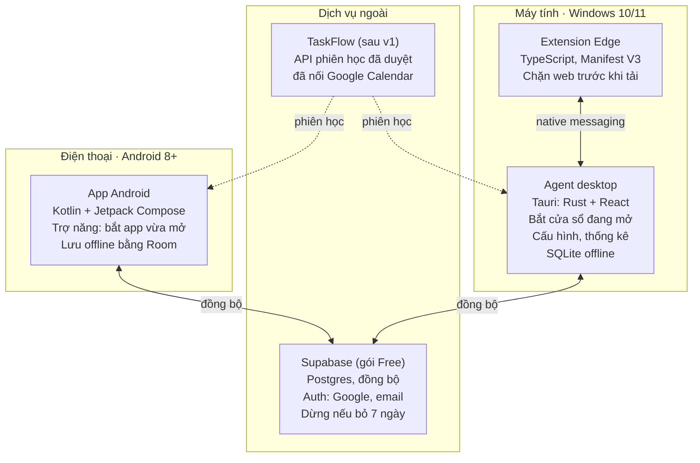

# Đặc tả DopaDam — chặn mở app vô thức, siết chặt trong giờ học

Đặc tả phiên bản 1 · Cập nhật: 12/10/2026 · Dang

## 1. Tổng quan

DopaDam chen một khoảng dừng có ý thức vào giữa cú bấm vô thức và nội dung giải trí, trên điện thoại Android và máy tính Windows, rồi siết khoảng dừng đó chặt hơn trong giờ học.

**Vấn đề.** Khi chán hoặc đang chờ một việc gì đó, người dùng mở app hay trang giải trí theo phản xạ, chỉ bằng vài cú bấm, trước khi kịp nghĩ. Quyết tâm bỏ thói quen có thật nhưng phai dần theo thời gian.

**Nhận định thiết kế.** Vấn đề không nằm ở thiếu ý chí mà ở chỗ thói quen chạy nhanh hơn suy nghĩ. Vì vậy ứng dụng không cấm, mà làm ba việc:

1. Chặn đúng lúc xung động xảy ra, trước khi trang hay app kịp hiện nội dung.
2. Khóa nút Vào vài giây, đủ để não chuyển từ chế độ tự động sang chế độ cân nhắc; muốn thoát thì lúc nào cũng được.
3. Đưa ngay một lựa chọn thay thế có vận động (nhảy dây, hít đất, đọc vài trang), vì ngồi yên chờ không phải là phương án thực tế.

**Mục tiêu đo được.** Tỉ lệ lần nhấn Thoát trên tổng số lần bị chặn tăng dần theo tuần; thời gian từ lúc thấy cảnh báo đến lúc bấm Thoát ngắn dần; số lần mở app giải trí trong phiên học giảm dần.

## 2. Phạm vi và nguyên tắc

Bản v1 là công cụ cá nhân: một người dùng duy nhất là chủ sở hữu, trên điện thoại Android và máy tính Windows của chính mình. Mọi thứ tự build và cài trực tiếp lên máy, không phát hành ra ngoài. Chi phí 0 đồng. Những gì cần khi mở cho người khác dùng được gom ở mục 13.

| Trong phạm vi v1 | Ngoài phạm vi v1 |
| --- | --- |
| App cho Android 8.0 trở lên | iOS, macOS, Linux |
| Agent desktop cho Windows 10 và Windows 11 | Windows 7, 8.1 |
| Extension cho Microsoft Edge | Chrome, Cốc Cốc, Brave, Firefox, Safari (trên Windows, các trình duyệt này được xử lý như app thường, FR01) |
| Trên Android: chặn theo app (trình duyệt được coi là một app) | Chặn theo tên miền trong trình duyệt trên điện thoại; danh sách link được phép trên điện thoại |
| Hướng dẫn cấp quyền cho điện thoại Xiaomi / Redmi / POCO (HyperOS, MIUI) | Hướng dẫn riêng cho các hãng khác |
| Một người dùng; đồng bộ giữa điện thoại và máy tính của người đó | Nhiều người dùng, tài khoản cho người khác, bảng xếp hạng |
| Chế độ Học: bật tay, khung giờ cố định | Lập lịch công việc và kết nối Google Calendar: thuộc về TaskFlow, một ứng dụng riêng (mục 6) |
| Đăng nhập bằng Google hoặc tài khoản email tự tạo | Đọc Gmail; AI |
| Tự build và cài trực tiếp lên máy | Phát hành: Google Play, Edge Add-ons, GitHub Releases, trang tải, ký số file cài, tự cập nhật; chặn cứng không cho vào |

**Nguyên tắc thiết kế**

- **Cảnh báo, không cấm.** Luôn vào được sau thời gian chờ; quyền quyết định thuộc về người dùng.
- **Ma sát tỉ lệ với nguy cơ.** Mở càng nhiều, hoặc đang trong giờ học, thì nút Vào càng bị khóa lâu. Không bắt gõ lý do: thời gian chờ chính là lúc tự hỏi bản thân.
- **Chặn trước khi nội dung hiện.** Thumbnail và video tự phát chính là mồi; màn hình cảnh báo phải xuất hiện trước chúng. Ngoại lệ duy nhất là app được đặt độ trễ cảnh báo, như game cần thời gian tải (FR10).
- **Thoát là lựa chọn dễ nhất.** Nút Thoát to, nổi bật, bấm được ngay từ giây đầu, là mặc định; phím Enter không bao giờ kích hoạt nút Vào, để thói quen "y Enter" không xuyên qua được.
- **Chạy offline trước, đồng bộ sau.** Việc chặn không phụ thuộc mạng.
- **Tắt bảo vệ cũng phải tốn công.** Tránh việc tự gỡ trong lúc bốc đồng.
- **Theo dõi tối thiểu.** Chỉ ghi tên app, tên miền, thời điểm và quyết định; không đọc nội dung màn hình.

**Cài đặt trong v1**

| Thành phần | Cách cài |
| --- | --- |
| App Android | Build file APK trên máy tính, cài vào điện thoại qua cáp USB (ADB) hoặc chép file APK sang rồi mở; sau đó làm theo màn hình kiểm tra quyền trong app |
| Agent Windows (app DopaDam trên máy tính, chạy ngầm ở khay hệ thống cạnh đồng hồ) | Build bằng Tauri ra file cài; chạy file cài một lần, agent tự chạy cùng Windows |
| Extension Edge | Mở `edge://extensions`, bật Chế độ nhà phát triển, chọn "Load unpacked" trỏ tới thư mục extension đã build |

**Có cần server không?** Không bắt buộc. Việc chặn chạy hoàn toàn trên thiết bị, nên nếu chỉ dùng một thiết bị thì không cần đăng nhập và mọi dữ liệu nằm yên trên máy. Server (Supabase) chỉ dùng để đồng bộ giữa điện thoại và máy tính, ví dụ bộ đếm và Chế độ Học. Mỗi thiết bị đăng nhập một lần, bằng một trong hai cách:

- **Đăng nhập bằng Google:** trên Android dùng hộp chọn tài khoản Google có sẵn của máy; trên Windows, agent mở trình duyệt để đăng nhập rồi nhận kết quả qua đường dẫn `dopadam://`.
- **Tạo tài khoản bằng email và mật khẩu:** đăng ký trong app, xác nhận qua email.

Hai cách cùng trỏ về một tài khoản nếu dùng chung một địa chỉ email. Extension không có màn hình đăng nhập riêng, vì nó lấy dữ liệu qua agent.

**Dịch vụ ngoài**

| Hạng mục | Dịch vụ | Giới hạn cần biết |
| --- | --- | --- |
| Đồng bộ và tài khoản | Supabase Free (Postgres, Auth) | Dự án tạm dừng sau 7 ngày không dùng; không có sao lưu tự động; email xác nhận dùng dịch vụ gửi mail có sẵn, chỉ được vài email mỗi giờ, đủ cho một người |
| Đăng nhập Google | OAuth client trên Google Cloud Console | Miễn phí; chỉ xin tên và email nên không cần Google duyệt app |
| Lưu mã nguồn | GitHub | Không bắt buộc; repo riêng tư hay công khai đều được |

## 3. Tên ứng dụng

**DopaDam**, ghép từ *dopamine* và *dam* (con đập). Đập nước không chặn dòng sông mà giữ nước lại rồi xả có kiểm soát; app cũng vậy: không cấm vào, chỉ ghìm cơn bốc đồng lại một nhịp trước khi nó tràn vào nội dung giải trí, đúng tinh thần cảnh báo chứ không phạt.

- Đọc là "đô-pa-đam". "Dam" là con đập trong tiếng Anh; logo và tên hiển thị tách hai phần (Dopa·Dam) để tránh đọc nhầm.
- Viết hoa hai chữ D (DopaDam), không viết thành "Dopadam" hay "DOPADAM".
- Biểu tượng gợi ý: một con đập nhỏ chắn dòng nước.
- Câu hỏi trên màn hình cảnh báo vẫn là "Bạn mở \[tên\] để làm gì?".
- Tên kỹ thuật: package Android `com.dang.dopadam`, repo `dopa-dam`, đường dẫn đăng nhập `dopadam://`.

## 4. Yêu cầu chức năng

Mười bảy chức năng, trong đó FR15 và FR16 để sau v1. Cột Nền tảng ghi Android, Windows (agent), Extension, hoặc Tất cả. Agent là app DopaDam trên máy tính: chạy ngầm ở khay hệ thống, theo dõi cửa sổ đang mở, hiện cảnh báo cho app desktop, chứa màn hình cấu hình và thống kê, và làm cầu nối giữa extension với server.

| Mã | Yêu cầu | Nền tảng |
| --- | --- | --- |
| FR01 | Quét toàn bộ app đã cài, cho gán tag: Giải trí, Game, Công việc, Học tập, Liên lạc, Tiện ích, Không theo dõi. Game được xử lý giống hệt Giải trí (chặn, đếm, cản trở), chỉ khác ở độ trễ cảnh báo mặc định (FR10); mọi chỗ nói "Giải trí" trong đặc tả này đều bao gồm Game. App mới cài thì nhắc gán tag. Trên Android, trình duyệt là một app như mọi app khác. Trên Windows, Edge mặc định ở nhóm Không theo dõi vì extension đã chặn theo tên miền; các trình duyệt khác (Chrome, Cốc Cốc…) được xử lý như app thường và nên gán Giải trí để không lách qua được. | Android, Windows |
| FR02 | Gán tag cho tên miền, áp dụng cho mọi tên miền con; có sẵn danh sách gợi ý (YouTube, Facebook, TikTok…). Kèm danh sách link được phép: các đường dẫn cụ thể nằm trong tên miền Giải trí nhưng dùng để học (playlist, video bài giảng) thì không bị chặn (mục 5). | Extension |
| FR03 | Mở app hoặc trang có tag Giải trí thì hiện màn hình cảnh báo phủ kín với câu hỏi "Bạn mở \[tên\] để làm gì?" (chỉ để tự hỏi, không có ô nhập), nút Thoát và nút Vào. | Tất cả |
| FR04 | Nút Thoát bấm được ngay; phím Enter và Esc đều tương ứng với Thoát. Nút Vào bị khóa trong thời gian chờ theo cấp (mục 5), đếm ngược hiện ngay trên nút, và chỉ bấm được bằng chuột hoặc chạm. | Tất cả |
| FR05 | Ghi mỗi lần chặn: đối tượng, cấp, quyết định, thời điểm hiện cảnh báo, số giây từ lúc hiện đến lúc bấm, phiên học liên quan. | Tất cả |
| FR06 | Trên màn hình cảnh báo có lối thay thế: nhảy dây, hít đất, đọc sách, kèm hẹn giờ 2–10 phút do người dùng chọn. | Tất cả |
| FR07 | Sau khi nhấn Vào, cấp "khoảng được phép" cho đúng đối tượng đó: chọn 5, 15 hoặc 30 phút ngoài giờ học; chỉ 5 hoặc 10 phút trong phiên học. Khoảng được phép áp dụng cho cả máy (mọi profile Edge trên máy tính đó), không lan sang thiết bị khác. Còn 1 phút thì hiện thông báo nhỏ để kịp dừng hoặc lưu; hết giờ thì hiện màn hình cảnh báo. | Tất cả |
| FR08 | Thống kê bằng biểu đồ cột theo ngày và tuần: số lần bị chặn (cột chồng Vào / Thoát), số giây trung bình đến lúc bấm Thoát, thời gian dùng theo tag kèm vạch ngân sách ngày; gộp cả điện thoại và máy tính. | Android, Windows |
| FR09 | Chế độ Học: bật tay với thời lượng và nhãn tự chọn, hoặc tự bật theo khung giờ cố định (mục 6). Khi đã đăng nhập, bật ở thiết bị nào thì thiết bị còn lại cũng vào chế độ này. | Tất cả |
| FR10 | Độ trễ cảnh báo: mỗi tag có một độ trễ mặc định, mỗi app có thể đặt độ trễ riêng ghi đè lên tag. Cảnh báo chỉ hiện sau khi app đã nằm ở phía trước đủ số giây đó, để không bị màn hình tải của game đè lên. Mặc định: Game 30 giây, các tag khác 0 giây (hiện ngay). Chi tiết ở mục 5. | Android, Windows |
| FR11 | Đăng nhập bằng Google hoặc tài khoản email và mật khẩu tự tạo (mục 2); đồng bộ tag, cài đặt, Chế độ Học và nhật ký giữa điện thoại và máy tính. Không đăng nhập vẫn dùng đầy đủ trên một thiết bị; mất mạng vẫn chặn bình thường. | Android, Windows |
| FR12 | Đồng bộ trong một máy tính: agent là nguồn dữ liệu chính; extension trên mọi profile Edge của máy đó nhận cấu hình và bộ đếm từ agent ngay lập tức; kiểm tra tương thích phiên bản giữa extension và agent (mục 8). Máy chưa cài agent thì extension chạy độc lập với cấu hình riêng. | Windows, Extension |
| FR13 | Màn hình kiểm tra quyền: kiểm tra từng quyền (Trợ năng, hiển thị trên ứng dụng khác, truy cập dữ liệu sử dụng, thông báo, chạy nền, và các quyền riêng của Xiaomi ở mục 7), tự phát hiện quyền còn thiếu, nút mở thẳng đúng màn hình cài đặt. Mở lại được bất cứ lúc nào qua trang Hướng dẫn (mục 7). | Android, Windows |
| FR14 | Các thao tác làm yếu bảo vệ phải chờ 60 giây và gõ một câu xác nhận: tắt bảo vệ, gỡ tag Giải trí, giảm thông số cản trở, tăng độ trễ cảnh báo, tăng ngân sách ngày, thêm link được phép, kết thúc Chế độ Học trước giờ, xóa nhật ký. Agent cảnh báo khi extension ngừng phản hồi; app Android cảnh báo khi mất quyền Trợ năng. | Tất cả |
| FR15 | Tự cập nhật (sau v1): app Android và agent tự kiểm tra bản mới và hướng dẫn cập nhật. | Android, Windows |
| FR16 | Cổng nối TaskFlow (sau v1): đọc phiên học đã duyệt từ API của TaskFlow, làm nguồn thứ ba cho Chế độ Học. Lịch Google đi vào DopaDam qua đường này, vì TaskFlow đã kết nối sẵn với Google Calendar. | Tất cả |
| FR17 | Giao diện tối mặc định cho mọi màn hình, kể cả màn hình cảnh báo. | Tất cả |

## 5. Cơ chế cảnh báo và cản trở tăng dần

Cấp cản trở được tính từ ba đầu vào: số lần đã bị chặn trong 60 phút gần nhất, việc người dùng có đang trong phiên học hay không, và tổng thời gian giải trí đã dùng trong ngày so với ngân sách.

**Cách đếm.** Gọi *n* là số lần màn hình cảnh báo đã hiện trong 60 phút trước đó, không tính lần đang xét.

- Mỗi lần cảnh báo hiện đều được đếm, dù người dùng chọn Thoát, Vào hay làm việc khác: cấp đo tần suất xung động, không đo quyết định.
- Lần mở nằm trong khoảng được phép còn hạn không hiện cảnh báo nên không được đếm.
- Khi đã đăng nhập, bộ đếm gộp cả điện thoại và máy tính; khi mất mạng, thiết bị dùng số đếm cục bộ cộng với số liệu đồng bộ gần nhất.
- Bộ đếm là cửa sổ trượt nên cấp tự hạ dần khi không mở thêm.

| Cấp | Điều kiện | Nút Vào bị khóa | Nút Thoát | Ghi chú |
| --- | --- | --- | --- | --- |
| 0 | Ngoài giờ học, *n* = 0 | 5 giây | Bấm được ngay | Mức khởi đầu |
| 1 | Ngoài giờ học, *n* = 1–2 | 10 giây | Bấm được ngay | Bắt đầu mở lặp lại |
| 2 | Ngoài giờ học, *n* ≥ 3 | 20 giây | Bấm được ngay | Đang mở theo phản xạ |
| 3 | Đang trong phiên học, hoặc đã vượt ngân sách ngày | 30 giây | Bấm được ngay | Khoảng được phép tối đa 10 phút (FR07) |

Các con số trên là mặc định, chỉnh được trong cài đặt. Tăng thời gian khóa thì có hiệu lực ngay; giảm thì phải qua bước xác nhận của FR14. Trong phiên học, mọi thông số cản trở và tag đều bị khóa.

**Ngân sách ngày.** Người dùng đặt tổng thời gian giải trí mỗi ngày, mặc định 90 phút, cộng dồn mọi app và trang có tag Giải trí trên cả điện thoại lẫn máy tính.

- Đây là ngân sách mềm: vượt ngân sách thì mọi lần mở đều ở cấp 3, nhưng vẫn vào được, đúng nguyên tắc cảnh báo chứ không cấm.
- Màn hình cảnh báo luôn hiện thời gian đã dùng hôm nay so với ngân sách, ví dụ "Hôm nay: 72 / 90 phút".
- Ngày được tính từ 4 giờ sáng đến 4 giờ sáng hôm sau, để thức khuya qua 0 giờ không làm ngân sách bị đặt lại.
- Giảm ngân sách thì có hiệu lực ngay; tăng thì phải qua bước xác nhận của FR14.
- Khi mất mạng, thiết bị cộng thời gian cục bộ với số liệu đồng bộ gần nhất.

**Link được phép (FR02).** Dùng khi cần học bằng nội dung nằm trên trang giải trí, chủ yếu là YouTube.

- Mỗi link được phép là một video cụ thể hoặc một playlist. Với playlist, mọi video mở trong playlist đó (đường dẫn có tham số `list=` trùng khớp) đều không bị chặn.
- Không hỗ trợ cho phép theo kênh: đường dẫn video không cho biết video thuộc kênh nào trước khi trang tải, mà chặn thì phải xảy ra trước khi trang tải. Muốn cho phép cả kênh thì gom video của kênh vào một playlist.
- Từ link được phép bấm sang video khác (kể cả video gợi ý, Shorts) thì bị chặn như thường; extension bắt cả các lần chuyển trang bên trong YouTube mà không tải lại trang.
- Link được phép có hiệu lực mọi lúc. Thời gian xem trên link được phép tính vào tag Học tập, không trừ vào ngân sách ngày.
- Thêm link phải qua bước xác nhận của FR14, kể cả trong phiên học (ngoại lệ duy nhất với quy tắc khóa cấu hình trong phiên học), để vẫn thêm được bài giảng mới giữa buổi học. Gỡ link thì có hiệu lực ngay.
- Chỉ áp dụng trên extension; app YouTube trên điện thoại không có đường dẫn để phân biệt.

**Báo trước khi hết khoảng được phép (FR07).** Còn 1 phút thì hiện thông báo nhỏ "Còn 1 phút", không che nội dung. Trên Android là thông báo hệ thống; trên Edge là thông báo của extension. Trên Windows, khi app hay game đang chạy toàn màn hình, thông báo hệ thống có thể bị chế độ tập trung của Windows ẩn đi, nên agent hiện một khung nhỏ luôn nằm trên cùng ở góc màn hình. Hết 1 phút thì hiện màn hình cảnh báo như một lần chặn mới.

**Độ trễ cảnh báo (FR10).** Game thường mất vài chục giây để tải và hay chiếm toàn màn hình khi tải xong; cảnh báo hiện quá sớm sẽ bị game đè lên. Vì vậy với app có độ trễ:

- Đếm số giây app nằm ở phía trước kể từ lúc mở. Chuyển sang app khác thì tạm dừng đếm, quay lại thì đếm tiếp. Đóng app trước khi hết độ trễ thì không có cảnh báo và không được đếm vào *n*.
- Hết độ trễ thì hiện cảnh báo đè lên app, cấp tính như bình thường. Trên Windows, nếu game chạy toàn màn hình độc quyền vẫn che cảnh báo, agent thu nhỏ game trước rồi mới hiện cảnh báo.
- Độ trễ chỉnh được theo tag và theo từng app, từ 0 đến 120 giây. Giảm độ trễ thì có hiệu lực ngay; tăng thì phải qua bước xác nhận của FR14, vì độ trễ càng dài thì càng được chơi lâu trước khi bị hỏi.
- Extension không dùng độ trễ: trang web luôn bị chặn trước khi tải.

**Đo mức tỉnh táo.** Mỗi lần chặn ghi lại số giây từ lúc màn hình cảnh báo hiện đến lúc bấm Thoát hoặc Vào. Thoát nhanh dần qua các tuần nghĩa là phản xạ dừng lại đã mạnh hơn. Ngược lại, thoát chậm, hoặc thường chờ hết đếm ngược rồi bấm Vào, là dấu hiệu nên tăng thời gian khóa.

**Luồng một lần chặn**

1. Phát hiện người dùng mở đối tượng có tag Giải trí, không nằm trong danh sách link được phép, và chưa có khoảng được phép còn hạn; nếu đối tượng có độ trễ thì chờ đủ độ trễ.
2. Tính cấp, hiện màn hình cảnh báo phủ kín. Trên trình duyệt, tab được chuyển sang trang cảnh báo của extension trước khi trang đích tải, nên không có thumbnail nào kịp hiện.
3. Màn hình hiển thị: câu hỏi "để làm gì" (chỉ để tự hỏi, không có ô nhập), đồng hồ đếm ngược trên nút Vào, số lần đã mở trong giờ qua, thời gian giải trí hôm nay so với ngân sách, và nếu đang học thì nhãn phiên học (tên tự đặt, hoặc tên phiên từ TaskFlow sau v1) cùng thời gian còn lại.
4. **Thoát** (bấm được ngay từ giây đầu; phím Esc hoặc Enter): trên trình duyệt thì đóng tab, nếu là tab duy nhất thì chuyển sang trang trống; trên Android thì về màn hình chính; trên Windows thì thu nhỏ cửa sổ app, không đóng app để tránh mất dữ liệu chưa lưu. Ghi lại số giây đã cân nhắc trước khi thoát.
5. **Làm việc khác**: chọn nhảy dây, hít đất hoặc đọc sách; bắt đầu hẹn giờ ngắn, hết giờ thì nhắc quay lại việc đang làm (kèm nhãn phiên học nếu đang học).
6. **Vào** (chỉ bấm chuột hoặc chạm, sau khi hết đếm ngược): chọn khoảng được phép, ghi nhật ký.

**Thiết kế màn hình cảnh báo:** nền gần đen, chữ lớn, không dùng màu đỏ báo động; nút Thoát to và có màu nhấn, nút Vào nhỏ và nhạt. Mục tiêu là bình tĩnh và rõ ràng, không làm người dùng thấy bị phạt.

## 6. Chế độ Học và cổng nối TaskFlow

Ứng dụng không tự lập lịch và không kết nối trực tiếp với Google Calendar. Phần chặn chỉ cần biết một điều: "bây giờ có đang trong giờ học không", và lấy câu trả lời từ các nguồn sau.

| Nguồn | Cách bật Chế độ Học | Có từ |
| --- | --- | --- |
| Bật tay | Chọn thời lượng (25, 50, 90 phút) và nhãn, ví dụ "Ôn Hệ điều hành"; bấm từ điện thoại, agent hoặc nút trên extension | v1 |
| Khung giờ cố định | Ví dụ thứ 2–6, 19:30–22:00; có ngoại lệ từng ngày | v1 |
| TaskFlow | Phiên học đã duyệt, đọc qua API của TaskFlow. TaskFlow đã kết nối Google Calendar, nên lịch Google đi vào DopaDam qua nguồn này | Sau v1 |

**Gộp các nguồn.** Đang học khi có ít nhất một nguồn đang có phiên còn hiệu lực. Khi nhiều phiên chồng nhau, nhãn hiển thị lấy theo thứ tự ưu tiên: bật tay, TaskFlow, khung giờ cố định. Kết thúc phiên trước giờ, hoặc thêm ngoại lệ cho ngày đang diễn ra phiên, phải qua bước xác nhận của FR14.

**Vì sao tách khỏi bộ lập lịch.** Mỗi app làm một việc: TaskFlow lên kế hoạch và giữ kết nối với lịch, DopaDam canh giữ giờ học. Nhờ vậy phần chặn không phải mang theo một bộ lập lịch thứ hai và có thể ra đời độc lập.

**Cổng nối TaskFlow.** Mọi nguồn đều cài cùng một interface `StudySessionSource`, trả về danh sách phiên gồm thời điểm bắt đầu, kết thúc và nhãn. Nối TaskFlow chỉ là viết thêm một adapter, phần chặn không phải sửa. Phía TaskFlow cần một endpoint chỉ đọc trả về các phiên làm việc đã duyệt của người dùng trong một khoảng thời gian.

**Đồng bộ trạng thái.** Bật tay ở thiết bị nào thì Supabase đẩy sang thiết bị còn lại. Khi mất mạng, mỗi thiết bị vẫn tự tính được Chế độ Học từ khung giờ cố định (và từ các phiên TaskFlow đã tải gần nhất, sau v1).

## 7. Trang Hướng dẫn

Trang Hướng dẫn mở được bất cứ lúc nào từ menu, trên cả Android và Windows, giao diện tối, tiếng Việt. Màn hình kiểm tra quyền lúc cài lần đầu (FR13) dùng chung nội dung với trang này.

| Phần | Nội dung |
| --- | --- |
| Kiểm tra tình trạng | Danh sách mọi quyền và thành phần, mỗi dòng có trạng thái đạt hoặc thiếu và nút "Sửa" mở thẳng đúng màn hình cài đặt. Trên Windows có thêm tình trạng agent và extension trên từng profile Edge. |
| Hướng dẫn cho Xiaomi | Các bước cho HyperOS và MIUI: bật Autostart, đặt Tiết kiệm pin thành "Không giới hạn", bật "Hiển thị cửa sổ bật lên khi chạy nền", khóa app trong màn hình đa nhiệm, Allow restricted settings. Hãng khác để sau v1. |
| App hoạt động thế nào | Bốn cấp khóa nút Vào, ngân sách ngày, link được phép, Chế độ Học, lối thay thế vận động, cách đọc biểu đồ số giây đến lúc Thoát. |

## 8. Kiến trúc và công nghệ

Ba thành phần chặn chạy cục bộ trên từng máy; Supabase lo tài khoản và đồng bộ; TaskFlow là nguồn phiên học sau v1 (nét đứt).

Mỗi máy tự chặn bằng dữ liệu cục bộ, nên mất mạng vẫn chặn được; Supabase chỉ giữ bản sao để điện thoại và máy tính thấy dữ liệu của nhau.

| Thành phần | Công nghệ | Vai trò |
| --- | --- | --- |
| App Android | Kotlin, Jetpack Compose, AccessibilityService, Room, WorkManager, UsageStatsManager | Bắt sự kiện đổi cửa sổ để biết app vừa mở, hiện màn hình cảnh báo, đo thời gian dùng, đồng bộ nền |
| Extension | TypeScript, Manifest V3, API webNavigation (gồm cả sự kiện chuyển trang bên trong trang như YouTube), chrome.storage, chrome.notifications; chạy trên Microsoft Edge | Chuyển tab sang trang cảnh báo của chính extension trước khi trang đích tải; kiểm tra link được phép; báo thời gian dùng theo tên miền cho agent |
| Agent desktop | Tauri 2 (lõi Rust, giao diện React + TypeScript), Win32 SetWinEventHook, SQLite; chạy trên Windows 10 và 11 | Bắt cửa sổ vừa lên phía trước, hiện cửa sổ cảnh báo luôn nằm trên cùng, chạy cùng Windows ở khay hệ thống, chứa giao diện cấu hình và thống kê |
| Lõi logic | Rust (agent), TypeScript (extension), Kotlin (Android); kiểm thử bằng một bộ test vector JSON dùng chung | Tính cấp cản trở, ngân sách ngày, độ trễ cảnh báo, và gộp các nguồn thành một trạng thái "đang học" duy nhất. Mỗi nền tảng hiện thực bằng ngôn ngữ của mình nhưng phải cho kết quả giống hệt nhau trên cùng bộ test vector |
| Supabase | Postgres, Auth (Google và email + mật khẩu), Row Level Security | Đăng nhập và đồng bộ giữa các thiết bị; không chứa logic chặn |

**Agent và extension là hai chương trình riêng.** Trình duyệt không cho app bên ngoài đọc URL đang mở, nên phần web phải do extension đảm nhận; ngược lại, extension không thấy được game hay app desktop, nên cần agent.

**Đồng bộ trong một máy tính.** Agent là nguồn dữ liệu chính của máy: giữ tag, bộ đếm, khoảng được phép, trạng thái Chế độ Học và hàng đợi đồng bộ lên Supabase. Extension là một client mỏng, nối vào agent qua Native Messaging và nhận thay đổi ngay; nếu dùng nhiều profile Edge thì mỗi profile có một bản extension, tất cả dùng chung một bộ đếm. Khi agent tạm không chạy, extension tự tính bằng bản cấu hình gần nhất và vẫn chặn được. Máy chưa cài agent thì extension chạy độc lập với cấu hình và bộ đếm riêng, không đồng bộ lên server.

**ID cố định cho extension.** Extension cài bằng "Load unpacked" có ID phụ thuộc vào thư mục chứa nó. Manifest khai báo trường `key` để ID không đổi, và agent đăng ký Native Messaging host theo đúng ID này.

**Đồng bộ phiên bản.** Agent, extension và app Android dùng chung một số phiên bản. Mỗi tin nhắn giữa extension và agent mang số phiên bản giao thức; nếu hai bên lệch quá mức tương thích, agent hiện thông báo cần build lại, còn extension tiếp tục chặn bằng cấu hình đã lưu chứ không ngừng hoạt động. Dữ liệu gửi lên Supabase cũng ghi phiên bản để thiết bị cũ không ghi đè sai định dạng của thiết bị mới.

## 9. Mô hình dữ liệu

Tám thực thể, tất cả phục vụ phần chặn và Chế độ Học. Mỗi thiết bị giữ bản đầy đủ cục bộ; khi đã đăng nhập, mọi bản ghi được đồng bộ đều mang thêm `user_id`, `updated_at` và `schema_version`. Trường `user_id` giữ sẵn để sau này mở cho nhiều người dùng mà không phải đổi cấu trúc.

| Thực thể | Trường chính | Ghi chú |
| --- | --- | --- |
| Device | id, platform (android / windows / extension), profile Edge (với extension), phiên bản, tên, lần cuối hoạt động | Phát hiện thành phần bị tắt và lệch phiên bản |
| TagRule | id, kind (app / domain / allow\_url), pattern (tên gói Android, tên file .exe, tên miền, hoặc video / playlist được phép), tag, độ trễ cảnh báo riêng (tùy chọn) | Độ trễ để trống thì dùng mặc định của tag; allow\_url là link được phép |
| Settings | thời gian khóa nút Vào từng cấp, độ trễ cảnh báo mặc định theo tag, các mức khoảng được phép, ngân sách giải trí mỗi ngày | Một bản ghi cho mỗi tài khoản (hoặc mỗi thiết bị khi không đăng nhập) |
| InterceptEvent | id, device\_id, đối tượng, tag, cấp, số giây khóa nút Vào, quyết định (vào / thoát / thay thế), số giây từ lúc hiện cảnh báo đến lúc bấm, study\_session\_id, thời điểm | Chỉ thêm, không sửa |
| AllowWindow | đối tượng, device\_id, hết hạn lúc | Theo máy, không đồng bộ lên server |
| UsageDaily | ngày (tính từ 4 giờ sáng), device\_id, tag, số phút | Chỉ thêm, không sửa; dùng để tính ngân sách ngày |
| StudyRule | id, khung giờ theo tuần, ngoại lệ ngày | Cấu hình Chế độ Học |
| StudySession | id, nguồn (manual / rule / taskflow), bắt đầu, kết thúc, nhãn, external\_id (mã phiên bên TaskFlow) | Bản ghi mỗi lần vào Chế độ Học |

**Quy tắc đồng bộ**

- Bảng cấu hình (TagRule, Settings, StudyRule, StudySession): bản ghi có `updated_at` mới hơn thì thắng.
- Bảng nhật ký (InterceptEvent, UsageDaily): chỉ thêm, không sửa, nên không bao giờ xung đột.
- Mọi bảng trên Supabase bật Row Level Security theo `user_id`, nên chỉ tài khoản đã đăng nhập mới đọc và ghi được dữ liệu của mình. Không đăng nhập thì dữ liệu chỉ nằm trên thiết bị, không gửi đi đâu.

## 10. Yêu cầu phi chức năng

Yêu cầu quan trọng nhất là tốc độ: màn hình cảnh báo phải xuất hiện trước khi nội dung kịp hiện, nếu không thì mồi đã được nuốt.

| Nhóm | Yêu cầu |
| --- | --- |
| Tốc độ | Cảnh báo hiện trước khi nội dung app hoặc trang kịp hiển thị. Ngưỡng cụ thể (mili giây) chốt sau khi đo trên thiết bị thật. |
| Tương thích | Android 8.0 trở lên; Windows 10 và 11; Microsoft Edge bản hỗ trợ Manifest V3. |
| Ổn định | Dịch vụ Trợ năng và agent chạy liên tục ít nhất 7 ngày mà không bị hệ điều hành tắt; nếu bị tắt thì tự phát hiện và báo ngay. |
| Pin | Sau một tuần dùng thật, app không nằm trong nhóm tốn pin nhất ở mục sử dụng pin của hệ thống. |
| Offline | Chặn, ghi nhật ký và Chế độ Học theo khung giờ cố định đều chạy khi mất mạng; đồng bộ bù khi có mạng lại. |
| Riêng tư | Chỉ ghi tên app, tên miền, thời điểm, quyết định và số giây cân nhắc. Không chụp màn hình, không đọc nội dung trang hay tin nhắn. Có nút xóa toàn bộ dữ liệu, cả trên máy lẫn trên server. |
| Bí mật | Phiên đăng nhập lưu trong Android Keystore và Windows Credential Manager, không lưu dạng văn bản thường. Khóa công khai (anon key) của Supabase nằm trong mã là bình thường vì đã có Row Level Security; khóa quản trị (service\_role) không bao giờ nằm trong mã nguồn hay trong app. |
| Bảo trì | Lõi logic tính cấp và gộp nguồn Chế độ Học tách riêng, có bộ test vector dùng chung cho ba nền tảng; mã ba thành phần nằm chung một monorepo, mỗi thành phần build được bằng một lệnh trên máy. |

**Giao diện tối**

- Một bộ token màu dùng chung cho cả ba nền tảng: nền gần đen, chữ trắng ngà, một màu nhấn duy nhất.
- Màn hình cảnh báo dùng cùng bộ token, không màu đỏ, không hiệu ứng nhấp nháy.
- Chữ lớn, độ tương phản đạt mức AA, giao diện tiếng Việt.

## 11. Giới hạn nền tảng và rủi ro

Rủi ro lớn nhất: hệ điều hành của một số hãng âm thầm tắt dịch vụ Trợ năng, làm điện thoại ngừng chặn mà không ai hay.

| Rủi ro | Ảnh hưởng | Cách xử lý |
| --- | --- | --- |
| Xiaomi (cùng Huawei, Oppo…) diệt tiến trình nền để tiết kiệm pin; khi app bị buộc dừng, quyền Trợ năng bị tắt theo ([fish-app](https://github.com/ahpxex/fish-app), [AppBlock](https://appblock.app/my-accessibility-keeps-turning-off-what-can-i-do-2/)). Đây là rủi ro trực tiếp vì máy dùng cho v1 là Xiaomi | Điện thoại ngừng chặn | Hướng dẫn Xiaomi ở mục 7 (Autostart, bỏ giới hạn pin, khóa app trong đa nhiệm); foreground service có thông báo thường trực; app tự kiểm tra quyền và báo khi mất |
| Từ Android 13, app cài ngoài cửa hàng có thể bị chặn bật Trợ năng ("Restricted setting") ([Esper](https://esper.io/blog/android-13-sideloading-restriction-harder-malware-abuse-accessibility-apis)); Android 15 siết thêm ([Android Authority](https://androidauthority.com/android-15-enhanced-confirmation-mode-3436697)) | Không bật được quyền cốt lõi | App info → menu ba chấm → Allow restricted settings ([Lawnchair docs](https://docs.lawnchair.app/troubleshooting/restricted-settings)) |
| Máy Xiaomi cần thêm quyền hiển thị cửa sổ bật lên khi chạy nền ([Salfeld](https://salfeld.com/en/faq/android/xiaomi/)) | Cảnh báo không hiện | Đưa vào danh sách kiểm tra quyền |
| Google bắt buộc xác minh nhà phát triển cho app cài ngoài Play, mở rộng toàn cầu từ 2027 ([Android Authority](https://androidauthority.com/android-sideloading-developer-verification-first-wave-rollout-3717921)) | Có thể phải đổi cách cài APK lên điện thoại | Cài qua ADB từ máy tính; nếu cách này cũng bị ảnh hưởng thì đăng ký tài khoản phân phối giới hạn miễn phí trên Android Developer Console ([Android Developers](https://developer.android.com/developer-verification/guides/limited-distribution)) |
| Edge thỉnh thoảng nhắc tắt extension cài ở chế độ nhà phát triển | Lỡ tay tắt extension | Agent cảnh báo khi extension ngừng gửi tín hiệu |
| Game đang tải hoặc chạy toàn màn hình đè lên cửa sổ cảnh báo | Cảnh báo không hiện | Độ trễ cảnh báo (FR10), mặc định 30 giây cho tag Game, chỉnh được theo từng app; nếu vẫn bị che, agent thu nhỏ game trước khi hiện cảnh báo |
| Extension bị tắt, mở cửa sổ InPrivate, hoặc dùng trình duyệt khác Edge | Lách qua trên máy tính | Bật quyền chạy trong cửa sổ InPrivate cho extension; gán tag Giải trí cho các trình duyệt khác (FR01); agent cảnh báo khi extension ngừng gửi tín hiệu |
| Mở trang giải trí qua trình duyệt trên điện thoại thay vì app | Lách qua trên điện thoại | Gán tag cho chính trình duyệt; chặn theo tên miền trên Android nằm ngoài phạm vi v1 |
| Supabase Free tạm dừng dự án sau 7 ngày không hoạt động ([Supabase](https://supabase.com/pricing)) | Ngừng đồng bộ | Dữ liệu vẫn còn, khôi phục từ dashboard; việc chặn không bị ảnh hưởng |
| Tự gỡ app trong lúc bốc đồng | Mất toàn bộ tác dụng | FR14 làm việc tắt tốn công hơn. Không ứng dụng nào ngăn được một người quyết tâm gỡ; mục tiêu là cắt chế độ lái tự động, không phải giam giữ |
| Mải chỉnh cấu hình ứng dụng thay vì học | Ứng dụng thành một kiểu trì hoãn mới | Khóa chỉnh tag và thông số cản trở trong phiên học |

## 12. Lộ trình

Extension làm trước vì nhỏ nhất và đánh trúng thói quen mở trang giải trí bằng phím tắt.

1. **Extension tối thiểu:** chặn danh sách tên miền cố định, trang cảnh báo tối, nút Vào khóa 5 giây, phím Enter không vượt qua được.
2. **App Android:** quét app, gán tag, dịch vụ Trợ năng, màn hình cảnh báo, nhật ký có số giây cân nhắc, kiểm tra quyền theo hãng.
3. **Agent Windows:** khay hệ thống, bắt cửa sổ phía trước, cửa sổ cảnh báo luôn trên cùng, nối với extension, kiểm tra phiên bản.
4. **Đồng bộ và cản trở tăng dần:** đăng nhập bằng Google hoặc email, đồng bộ điện thoại và máy tính, bốn cấp khóa nút Vào, ngân sách ngày, link được phép, báo trước 1 phút, độ trễ cảnh báo, lối thay thế vận động, biểu đồ thống kê.
5. **Chế độ Học:** khung giờ cố định, bật tay đồng bộ hai thiết bị, interface `StudySessionSource`.

## 13. Sau v1

Những phần dưới đây chỉ làm khi có thêm người dùng khác, hoặc khi TaskFlow sẵn sàng.

| Hạng mục | Nội dung |
| --- | --- |
| Nhiều người dùng | Mỗi người một tài khoản riêng, đăng nhập tùy chọn; RLS theo `user_id` đã có sẵn từ v1 |
| Trình duyệt khác | Extension cho Chrome, Cốc Cốc, Brave (cùng mã nguồn Manifest V3) |
| Phát hành | Edge Add-ons; GitHub Releases cho APK và file cài Windows; trang tải và chính sách quyền riêng tư trên GitHub Pages; phân phối Android giới hạn (tối đa 20 thiết bị); ký số file cài Windows để tránh cảnh báo SmartScreen |
| Tự cập nhật | FR15 |
| Cài đặt cho người không rành công nghệ | Hướng dẫn có ảnh chụp từng bước, hướng dẫn quyền cho các hãng điện thoại khác Xiaomi (tự nhận diện hãng), phần câu hỏi thường gặp trong trang Hướng dẫn, README |
| TaskFlow | FR16: adapter TaskFlow cho `StudySessionSource`. Chế độ Học tự bật theo phiên học đã duyệt, kể cả các phiên TaskFlow lấy từ Google Calendar |

## 14. Nguồn tham khảo

- [Android Authority — Developer verification first wave](https://androidauthority.com/android-sideloading-developer-verification-first-wave-rollout-3717921): quy định xác minh nhà phát triển có hiệu lực từ 30/9/2026 ở bốn nước, toàn cầu từ 2027.
- [Android Developers — Limited distribution](https://developer.android.com/developer-verification/guides/limited-distribution): tài khoản miễn phí, chia sẻ cho tối đa 20 thiết bị.
- [Supabase — Pricing](https://supabase.com/pricing): gói Free tạm dừng dự án sau 1 tuần không hoạt động, không có sao lưu tự động.
- [Esper — Android 13 restricted settings](https://esper.io/blog/android-13-sideloading-restriction-harder-malware-abuse-accessibility-apis): chặn Trợ năng với app cài ngoài cửa hàng.
- [Lawnchair docs — Restricted settings](https://docs.lawnchair.app/troubleshooting/restricted-settings): cách bật Allow restricted settings.
- [Android Authority — Android 15 Enhanced Confirmation Mode](https://androidauthority.com/android-15-enhanced-confirmation-mode-3436697): cơ chế siết chặt hơn từ Android 15.
- [fish-app (GitHub)](https://github.com/ahpxex/fish-app): app chặn dùng Trợ năng, ghi chú về việc buộc dừng làm mất quyền.
- [AppBlock — Accessibility keeps turning off](https://appblock.app/my-accessibility-keeps-turning-off-what-can-i-do-2/): các hãng tắt dịch vụ Trợ năng để tiết kiệm pin.
- [Salfeld — Xiaomi permissions](https://salfeld.com/en/faq/android/xiaomi/): quyền Autostart và cửa sổ bật lên khi chạy nền.
